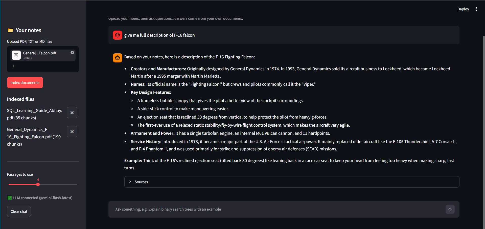
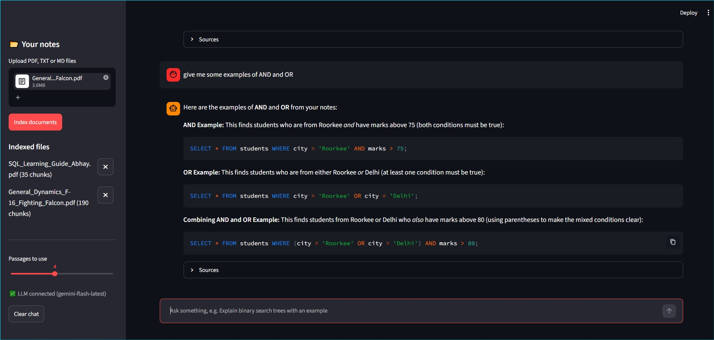

# 📚 College Study Assistant

Upload your college notes and PDFs, then ask questions in plain English. The app finds the
right parts of your documents and writes an easy answer, and it shows you **which file and
page** the answer came from.

This is a **RAG (Retrieval-Augmented Generation)** project built in Python.

## How it works

```
 PDF / TXT  ->  extract text  ->  split into chunks  ->  embeddings  ->  FAISS index
                                                                            |
 Your question  ->  embedding  ->  find top matching chunks  <-------------+
                                          |
                        chunks + question -> LLM (Gemini) -> answer + sources
```

1. **Extract**: PyMuPDF reads the text of each page.
2. **Chunk**: text is cut into pieces of about 180 words, with 40 words of overlap.
3. **Embed**: each chunk becomes a vector using `all-MiniLM-L6-v2` (runs on your laptop, no API cost).
4. **Search**: FAISS finds the chunks most similar to your question (cosine similarity).
5. **Re-rank (hybrid search)**: exact keyword matches add a small bonus, so short questions like "what's VIEW?" still find the right page. Weak passages are dropped.
6. **Generate**: the best chunks are sent to the Gemini API with a prompt that says "answer only from these notes".
7. **Cite**: the app shows the file name and page of every chunk it used.

If you have no API key, or Google is down, the app still works: it shows the best matching passages instead of a written answer. Short Google problems (timeouts, "high demand" errors) are retried automatically, and if a model name is removed the app finds a current one.

## Tech stack

| Tool | Use |
| --- | --- |
| Python 3.10+ | Main language |
| Streamlit | Web interface |
| PyMuPDF | PDF text extraction |
| sentence-transformers | Embeddings |
| FAISS | Vector similarity search |
| Gemini API | Answer generation |
| pytest | Unit tests |

## Screenshots





## Setup

```bash
git clone https://github.com/abhaygujjar/college-study-assistant.git
cd college-study-assistant

python -m venv venv
venv\Scripts\activate          # Windows
# source venv/bin/activate     # Mac / Linux

pip install -r requirements.txt
```

Get a free API key from [Google AI Studio](https://aistudio.google.com/apikey), then:

```bash
copy .env.example .env         # Windows   (Mac/Linux: cp .env.example .env)
```

Open `.env` and paste your key after `GEMINI_API_KEY=`.

## Run

```bash
streamlit run app.py
```

If the page ever shows "Connection error" while indexing, start it with `streamlit run app.py --server.fileWatcherType none`. This turns off Streamlit's file watcher, which can clash with PyTorch on some Windows setups. The app also guards against this in `embedder.py`.

The first start downloads the embedding model (about 90 MB). After that it is fast.

## Use it

1. Upload one or more PDF / TXT / MD files in the sidebar.
2. Click **Index documents**.
3. Ask a question, for example: *"Explain binary search trees with an example."*
4. Open **Sources** under the answer to see the exact pages used.

## Run the tests

```bash
python -m pytest
```

## Project structure

All files are in one folder, no sub-folders.

```
college-study-assistant/
├── app.py               # Streamlit interface
├── pdf_loader.py        # read PDF / TXT files
├── text_chunker.py      # split text into overlapping chunks
├── embedder.py          # text -> vectors
├── vector_store.py      # FAISS search (NumPy fallback)
├── llm_client.py        # Gemini call, retries + fallback answer
├── rag_pipeline.py      # connects everything, hybrid search
├── test_basics.py       # unit tests
├── requirements.txt
├── .env.example
├── .gitignore
├── LICENSE
├── answer1.jpg          # screenshots
└── answer2.jpg
```

## Limits (and ideas to improve)

- Scanned PDFs (only images) have no text. Adding OCR (e.g. Tesseract) would fix this.
- The index lives in memory, so it is rebuilt when the app restarts. Saving the FAISS index to disk is a good next step.
- Chunking is by words. Splitting by headings or sentences could improve answer quality.
- There is no chat memory, so each question is searched on its own. A follow-up like "give me an example" needs the earlier topic. Adding the last few messages to the search would fix this.
- Keyword matching is simple. A proper BM25 index or a cross-encoder re-ranker would be more accurate.

## What I learned

RAG, text chunking, embeddings, vector search, hybrid retrieval, prompt design to reduce wrong
answers, handling API errors (timeouts, retries, removed models), and building a small AI app
end to end.

## License

MIT
